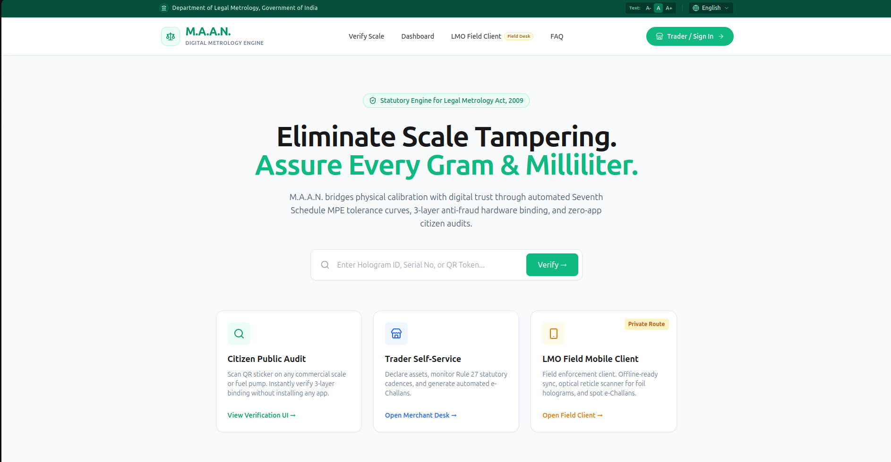

# ⚖️ M.A.A.N. — Digital Metrology Engine
### **Metrological Assurance, Authentication & Network**
*Statutory Engine for Legal Metrology Act, 2009 — Eliminate Scale Tampering. Assure Every Gram & Milliliter.*

---

### 🎥 **OFFICIAL MVP DEMO WALKTHROUGH**
> **Note for Evaluators & Judges:** Watch our end-to-end prototype demonstration below:
>
> - ▶️ **[Open Full SIH26_TechTitans Demo Playlist (Web + LMO Field Client)](https://youtu.be/p6_TL-mJ3M0?si=B8sRfw_Ry4RDjNI5)**

---

## 📌 Problem & Overview

Traditionally, enforcement and compliance under the **Legal Metrology Act, 2009** rely on fragmented, offline paper certificates and physical lead/wax stamps—making real-time tracking difficult and physical scale tampering easy to conceal.

**M.A.A.N.** bridges physical calibration with digital trust through **automated Seventh Schedule MPE (Maximum Permissible Error) tolerance curves**, a **3-layer anti-fraud hardware binding ledger**, and **zero-app citizen audits**, uniting Citizens, Traders, and Legal Metrology Officers (LMOs) on a single real-time governance network.

---

## 🚀 Core Modules & Portal Workflows

### 1. 🔍 Citizen Public Audit (`/audit` & `/verify`)
* **Zero-App Instant Verification:** Citizens can scan a QR sticker on any commercial weighing scale or fuel pump—or manually enter a **Hologram ID**, **Serial Number**, or **QR Token** directly from the hero verification bar.
* **3-Layer Hardware Binding Check:** Cross-verifies the physical chassis serial, security foil hologram, and cryptographic QR token against the central ledger in real time.
* **Anomaly & Tamper Reporting:** Flags expired calibration certificates or mismatched hardware bindings immediately.

### 2. 🏪 Trader Self-Service & Merchant Desk (`/login`, `/register`, `/dashboard`)
* **Dual-Flow Trader Authentication (`TraderLogin`):**
  * **Sign In & Business Registration Tabs:** Seamless switching between existing merchant sign-in and new business onboarding.
  * **Format-Validated Identifiers:** Built-in GSTIN format verification alongside mobile-linked 6-digit OTP authentication and assisted Digital Seva (VLE) access.
* **Rule 27 Compliance Dashboard:** Enables shop owners to declare weighing assets, track statutory re-verification cadences under Rule 27, view official notices, and settle automated **e-Challans**.

### 3. 📱 LMO Field Client — Private Route (`/inspector` & `/inspector/login`)
* **Dedicated Field Enforcement Suite:** Protected route engineered for Legal Metrology Officers conducting on-ground inspections.
* **Optical Reticle Scanner & Offline-Ready Sync:** Captures foil holograms, verifies Seventh Schedule MPE tolerance curves, and issues spot **e-Challans** with offline-ready synchronization to the central database.

---

## 🏗️ System Architecture

<pre>
+-----------------------------------------------------------------------------+
|                          M.A.A.N. TRUST ECOSYSTEM                           |
+-----------------------------------------------------------------------------+
        |                              |                              |
        v                              v                              v
+----------------+            +-----------------+            +----------------+
|  Citizen Web   |            |   Trader Desk   |            | LMO Field Desk |
|  Public Audit  |            |  Self-Service   |            | Private Route  |
| (/audit,/verify|            | (/login,/dash)  |            |  (/inspector)  |
+----------------+            +-----------------+            +----------------+
         \                             |                             /
          \                            |                            /
           v                           v                           v
+-----------------------------------------------------------------------------+
|                     FastAPI REST & Verification Engine                      |
|         • Seventh Schedule MPE Tolerance Curve Validator                    |
|         • Rule 27 Statutory Re-Verification Cadence Engine                  |
|         • Automated Spot e-Challan & Digital Certificate Issuer             |
+-----------------------------------------------------------------------------+
                                       |
                                       v
+-----------------------------------------------------------------------------+
|                 PostgreSQL Central Hardware Binding Ledger                  |
|    [Layer 1: Chassis Serial] + [Layer 2: Foil Hologram] + [Layer 3: QR]     |
+-----------------------------------------------------------------------------+
</pre>

---

## 📂 Complete Repository Structure

<pre>
M.A.A.N/
├── backend/                        # FastAPI Verification Engine & PostgreSQL Models
├── docs/                           # Architecture diagrams, statutory references & assets
└── frontend/                       # Next.js (App Router) TypeScript Web Application
    ├── app/
    │   ├── audit/                  # Citizen Public Audit & 3-layer receipt view
    │   ├── dashboard/              # Trader Self-Service & Rule 27 compliance desk
    │   ├── fonts/                  # Local web font configurations
    │   ├── inspector/              # LMO Field Client (Private Route)
    │   │   ├── login/              # Dedicated LMO officer authentication
    │   │   │   └── page.tsx
    │   │   └── page.tsx            # Field enforcement, reticle scanner & spot e-Challan UI
    │   ├── login/                  # Trader / Shop Access & Business Registration
    │   │   └── page.tsx            # GSTIN validation & 6-digit OTP verification flow
    │   ├── portal/                 # Unified role-based portal redirection
    │   ├── register/               # New merchant & weighing asset registration
    │   ├── verify/                 # Direct QR Token / Hologram ID lookup route
    │   ├── globals.css             # Global Tailwind directives & accessibility themes
    │   ├── icon.png                # Application branding icon
    │   ├── layout.tsx              # Root App Router layout & metadata
    │   ├── Navbar.tsx              # Government header bar (Text scaling, Locale, Nav)
    │   └── page.tsx                # Landing page with Hero verification & module cards
    ├── components/
    │   ├── inspector/              # LMO field inspection & optical scanner modules
    │   ├── ui/                     # Reusable atomic UI primitives
    │   ├── CitizenPublicAudit.tsx  # Interactive public verification widget
    │   ├── Hero.tsx                # Hero search bar (Hologram ID, Serial No, QR Token)
    │   └── Navbar.tsx              # Top navigation & Trader / Field Desk quick links
    ├── hooks/                      # Custom React state & verification hooks
    ├── lib/                        # MPE tolerance utilities, API helpers & constants
    ├── public/                     # Static assets, emblems & sample QR payloads
    ├── next.config.mjs             # Next.js build configuration
    ├── package.json                # Frontend dependencies & scripts
    └── postcss.config.mjs          # PostCSS & Tailwind CSS pipeline
</pre>

---

## 💻 Tech Stack

| Layer | Technology | Key Responsibilities |
| :--- | :--- | :--- |
| **Frontend Framework** | **Next.js (App Router), React 18, TypeScript** | Server & client rendering across Citizen, Trader, and LMO routes |
| **Styling & Accessibility** | **Tailwind CSS, Lucide Icons** | Government-compliant UI with dynamic text-size controls (`A-` `A` `A+`) and multi-language readiness |
| **Field Client** | **LMO Field Desk (`/inspector`) & Mobile Client** | Offline-ready sync, optical reticle scanner for foil holograms, and spot e-Challan generation |
| **Backend API** | **FastAPI (Python)** | Seventh Schedule MPE curve validation, Rule 27 cadence tracking, and ledger verification |
| **Database** | **PostgreSQL** | Tamper-evident relational ledger storing 3-layer hardware bindings and audit trails |

---

## ⚙️ Local Development Setup

### 1. Clone the Repository
<pre>
git clone [https://github.com/sagarutkarsh-dev/M.A.A.N.git](https://github.com/sagarutkarsh-dev/M.A.A.N.git)
cd M.A.A.N
</pre>

### 2. Start the Next.js Frontend
<pre>
cd frontend
npm install
npm run dev
</pre>
Open **`http://localhost:3000`** in your browser to explore the Citizen Audit bar, Trader Desk (`/login` & `/dashboard`), and LMO Field Client (`/inspector`).

### 3. Start the FastAPI Backend *(Optional)*
<pre>
cd ../backend
python3 -m venv venv
source venv/bin/activate
pip install -r requirements.txt
uvicorn main:app --reload --port 8000
</pre>

---

## 👥 Team TechTitans

Engineered for **Smart India Hackathon (PS26036)** under the **Department of Legal Metrology, Government of India** problem track to modernize statutory weights and measures compliance nationwide.
